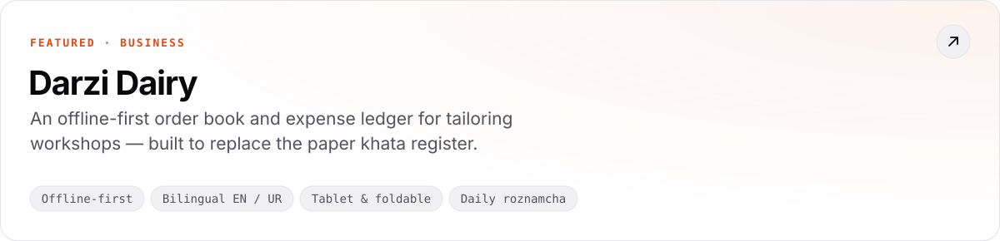
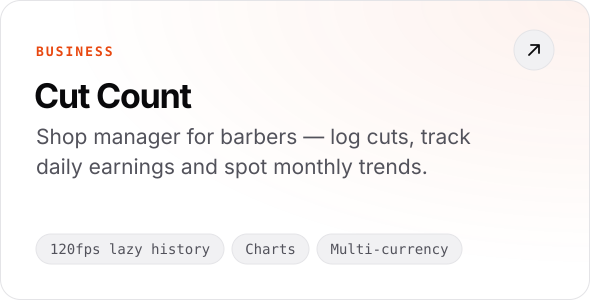
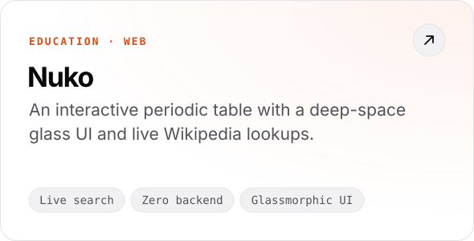
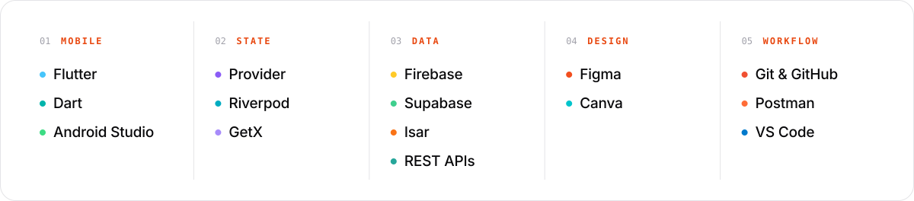

<!-- Artwork is generated by scripts/build_readme_assets.py — edit copy there, not in the SVGs. -->

<picture>
  <source media="(prefers-color-scheme: dark)" srcset="./assets/readme/banner-dark.svg">
  
</picture>

  

I care about the details people *feel* but rarely notice — spacing, motion, how quickly a tap responds. Most of what I build is for real, unglamorous workflows: the tailors and barbers down my street who still run their business out of a paper notebook.

 

### Selected work

<a href="https://github.com/fazal-e-haq/DarziDairy">
  <picture>
    <source media="(prefers-color-scheme: dark)" srcset="./assets/readme/darzi-dairy-dark.svg">
    
  </picture>
</a>

<a href="https://github.com/fazal-e-haq/CutCount"><picture><source media="(prefers-color-scheme: dark)" srcset="./assets/readme/cut-count-dark.svg"></picture></a>
<a href="https://github.com/fazal-e-haq/Nuko"><picture><source media="(prefers-color-scheme: dark)" srcset="./assets/readme/nuko-dark.svg"></picture></a>

 

### Toolkit

<picture>
  <source media="(prefers-color-scheme: dark)" srcset="./assets/readme/stack-dark.svg">
  
</picture>

 

### Activity

<picture>
  <source media="(prefers-color-scheme: dark)" srcset="https://raw.githubusercontent.com/fazal-e-haq/fazal-e-haq/output/github-snake-dark.svg">
  
</picture>

  

  <a href="https://fazal-portfolio.web.app"><b>Portfolio</b></a>&nbsp;&nbsp;·&nbsp;&nbsp;
  <a href="https://www.linkedin.com/in/fazal-e-haq3"><b>LinkedIn</b></a>&nbsp;&nbsp;·&nbsp;&nbsp;
  <a href="https://www.freelancer.com/u/FazalehaqDev"><b>Freelancer</b></a>&nbsp;&nbsp;·&nbsp;&nbsp;
  <a href="https://www.instagram.com/fazalehaq.dev"><b>Instagram</b></a>&nbsp;&nbsp;·&nbsp;&nbsp;
  <a href="mailto:fazal.e.haq216@gmail.com"><b>fazal.e.haq216@gmail.com</b></a>

