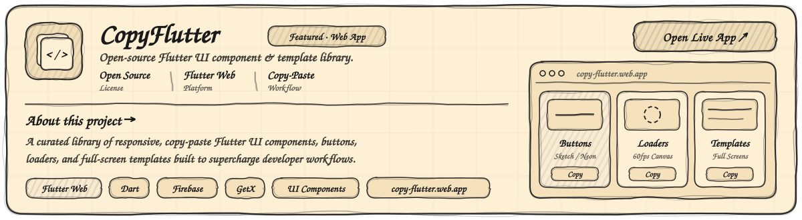
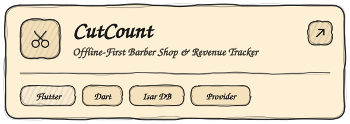
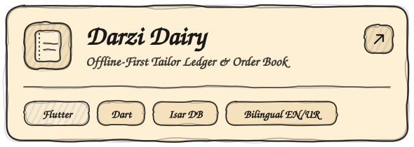
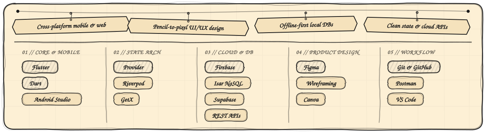

<!-- Pencil-sketch SVG artwork is generated by scripts/build_readme_assets.py -->

  

 

### ✏️ Projects

  
  

 

### 🛠️ Tech Stack

  

  <a href="https://fazal-portfolio.web.app"><b>Portfolio</b></a>&nbsp;&nbsp;·&nbsp;&nbsp;
  <a href="https://copy-flutter.web.app"><b>CopyFlutter</b></a>&nbsp;&nbsp;·&nbsp;&nbsp;
  <a href="https://www.linkedin.com/in/fazal-e-haq3"><b>LinkedIn</b></a>&nbsp;&nbsp;·&nbsp;&nbsp;
  <a href="https://www.freelancer.com/u/FazalehaqDev"><b>Freelancer</b></a>&nbsp;&nbsp;·&nbsp;&nbsp;
  <a href="https://www.instagram.com/fazalehaq.dev"><b>Instagram</b></a>&nbsp;&nbsp;·&nbsp;&nbsp;
  <a href="mailto:fazal.e.haq216@gmail.com"><b>fazal.e.haq216@gmail.com</b></a>

